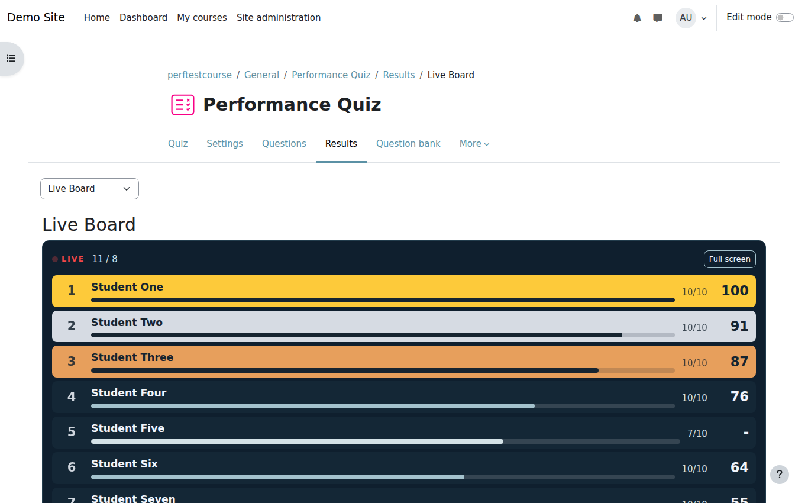
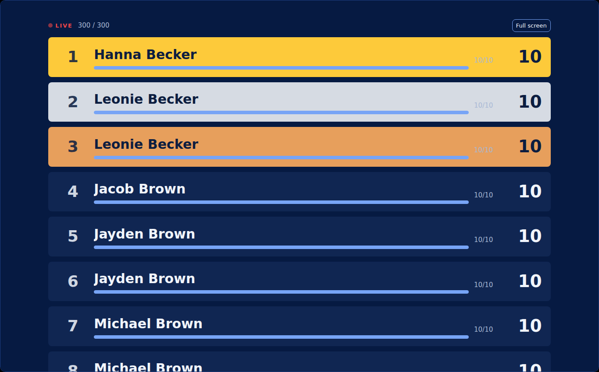
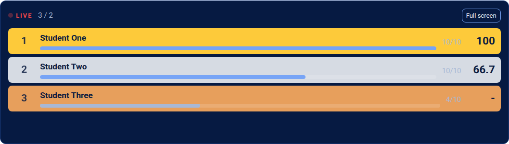
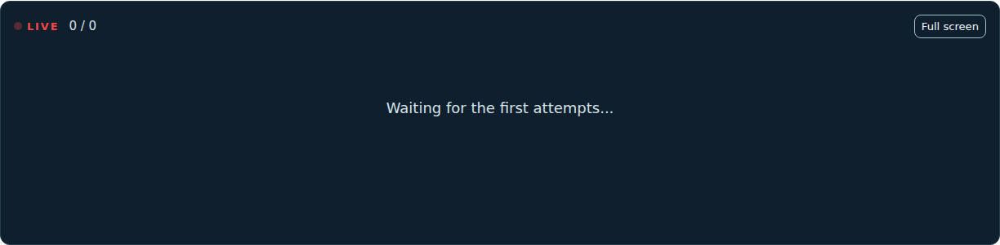

# Moodle Quiz Live Board

A Kahoot-style **live scoreboard** for Moodle quizzes, as a quiz report
subplugin. While students take a quiz, the teacher opens
**Results → Live Board**, projects it, and the board shows - per student -
how many questions they have answered and their current grade, sorted by
score, auto-refreshing every 5 seconds.

## Features

- Ranked rows: position, name, score bar (finished) or progress bar
  (in-progress), answered `n/slots`, big score; top 3 in medal colors.
- Pulsing LIVE indicator, started / finished counters.
- **Full screen** button: presentation mode with scaled-up typography.
- Reads core quiz tables only - nothing stored, null privacy provider.
- Teacher-only via the default `mod/quiz:viewreports` gate. Zero settings.
- UI in English and Indonesian. Moodle 4.5 (LTS) → 5.2, CI matrix on
  mariadb + pgsql for every branch.

## Screens

### Presentation mode

The Full screen button turns the whole viewport into the projector view -
scaled-up names, ranks and scores, board chrome only.

### A small class

Three students mid-quiz: medal rows for the podium, blue bars for finished
scores, muted bars for attempts still in progress (grade lands at submit
with the default deferred-feedback behavior).

### Waiting for the first attempts

Before anyone starts, the board shows a waiting note; it disappears as soon
as the first attempt lands.

## How it works

One aggregate SQL per poll over `quiz_attempts` x `question_attempts` x
`question_attempt_steps` (latest step per question, answered-state
whitelist); the grade is rescaled from the latest attempt's own `sumgrades`
with the same formula as the overview report, so the two always agree -
preview attempts (teacher previews, log-in-as) are excluded like the
overview. Milliseconds for a classroom, no question-usage loads. A PHPUnit test guards the query on all supported
branches.

## Install

Install as any plugin: the repo root is the `quiz_liveboard` subplugin; drop
it (or `git clone` it) as `mod/quiz/report/liveboard/` and visit site
administration notifications.
